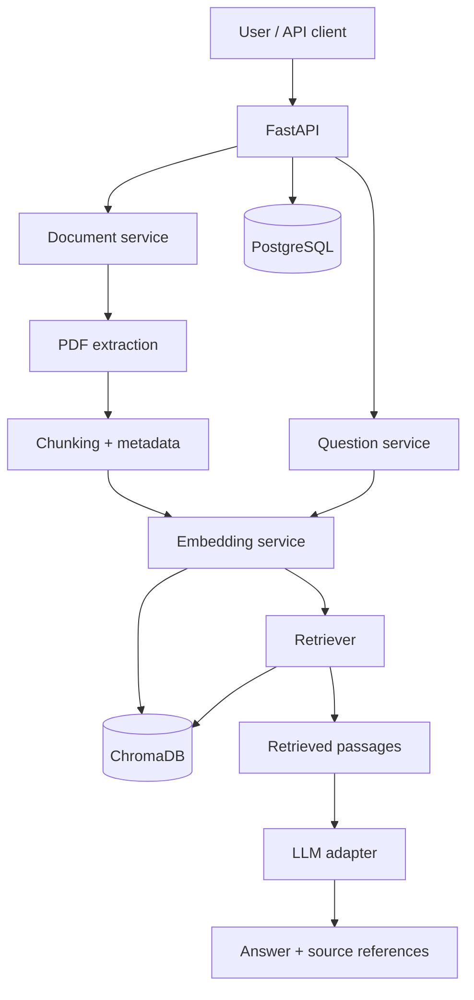

# Architecture — Initial Design
**Status:** Draft v0.1

## Approach
Use a modular monolith: one FastAPI backend with clear internal boundaries. This avoids premature microservices while keeping components independently testable. Add Vue.js after the API workflow works.

## High-level flow

## Responsibilities
- API: request/response validation and HTTP handling.
- Document service: upload workflow and lifecycle.
- PDF extraction: extract text and page metadata; scanned PDFs initially out of scope.
- Chunking: split text and preserve document/page metadata.
- Embedding service: embed documents and questions.
- Vector-store adapter: ChromaDB storage and retrieval.
- Retriever: select relevant passages and apply document filters.
- LLM adapter: isolate provider-specific calls.
- Question service: orchestrate retrieval, context construction, generation, and source mapping.
- PostgreSQL: application metadata and later user/permission records.

## Data boundaries
PostgreSQL is the source of truth for application metadata. ChromaDB stores vectors and retrieval metadata. Vector metadata alone must never authorize access. Version 2 must check authorization in the backend and test cross-user isolation.

## Provider independence
Embedding and generation are separate concerns. The same embedding model/version must be used for indexing and querying. The LLM provider must be replaceable without changing API contracts.

## Local-first setup
Develop natively on macOS first. Keep model files small. Add Docker Compose when the service topology is stable and reproducibility benefits justify it.

## Open questions
PDF extraction library; suitable small embedding model; first local/API LLM; deletion consistency across PostgreSQL and ChromaDB; initial RAG evaluation set.
